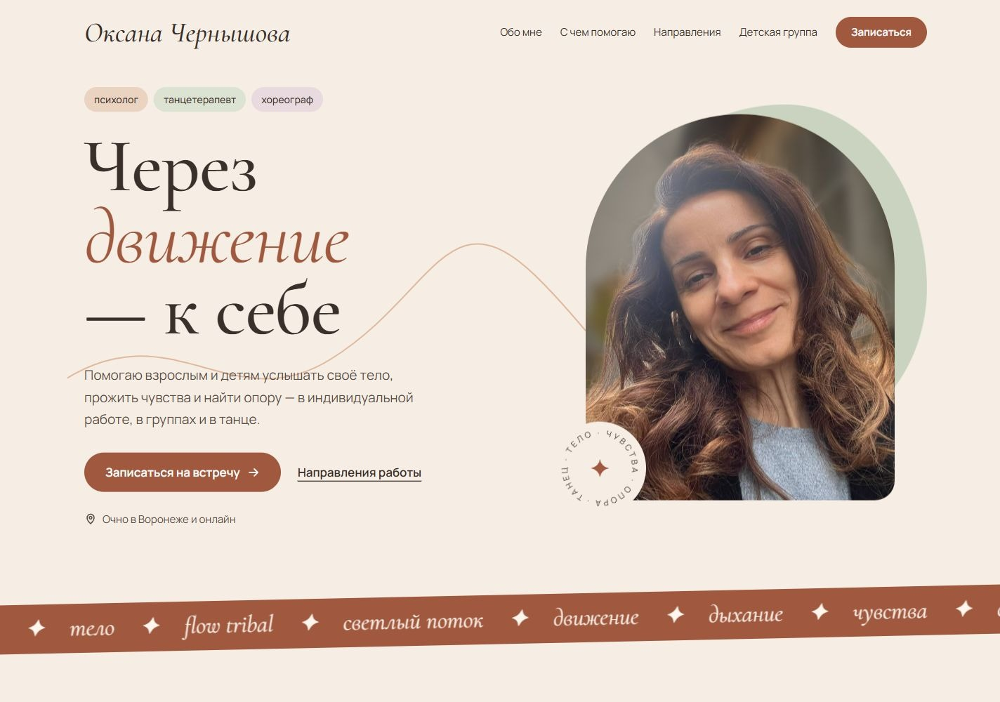

# Другие танцы

**Сайт-визитка психолога, танцетерапевта и хореографа.**

🔗 **[другиетанцы.рф](https://другиетанцы.рф)**

> Это витрина работы: описание проекта и скриншоты настольной и мобильной версий.

---

## Задача

Собрать в одном месте знакомство со специалистом, направления работы, форматы встреч, стоимость и контакты. Помочь посетителю понять, с чем можно обратиться, и перейти к общению в удобной социальной сети или мессенджере.

## Что на странице

- **Первый экран** с портретом в арке и заголовком «Через движение — к себе».
- **О специалисте**: подход, образование, опыт и фотографии практик.
- **С чем можно прийти**: основные запросы для индивидуальной работы.
- **Направления**: танцевально-двигательная и телесно-ориентированная терапия.
- **Детская группа** развивающего танца для детей 4–9 лет.
- **Форматы и стоимость**, ссылки для записи и знакомства.

## Визуальное решение

Тёплый кремовый фон, терракотовые и шалфейные акценты, плавные формы и фотографии в арочных рамках. Крупные заголовки с курсивом и рукописные заметки поддерживают личный характер страницы. Движение передают CSS-анимации и декоративная бегущая строка.

## Как сделано

- Статическая страница на **HTML и CSS**, без фреймворков и сборки.
- Разработка с помощью ИИ; постановка задачи, проверка результата и доводка — мои.
- Гибкая вёрстка для настольных и мобильных экранов.
- Шрифты **Cormorant Garamond, Manrope и Caveat** размещены локально.
- Анимации учитывают системную настройку уменьшения движения.
- Подготовлены метаданные для поисковиков, Open Graph, Twitter Card и структурированные данные Schema.org.
- Запись через ссылки на контакты, без формы на странице.
